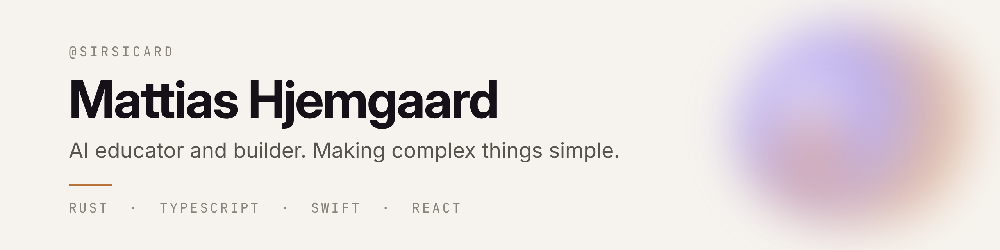
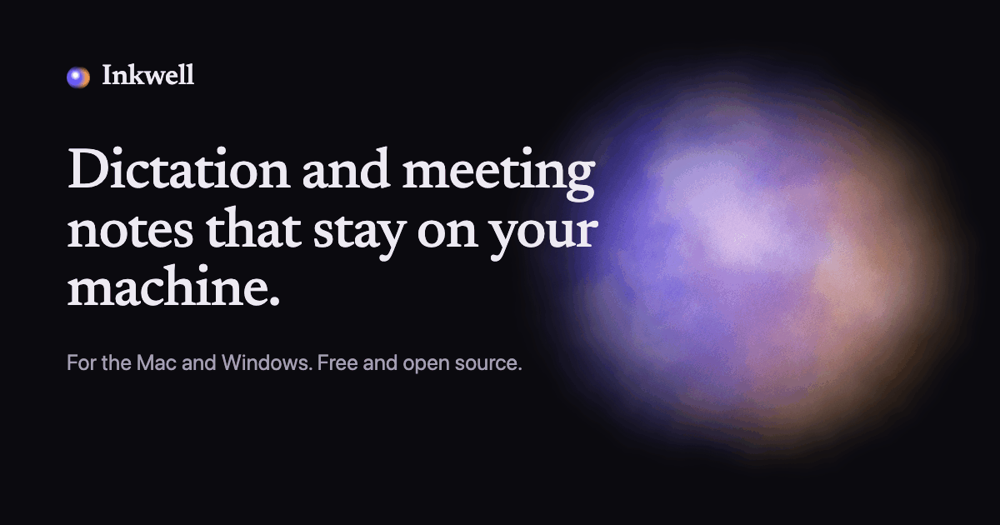
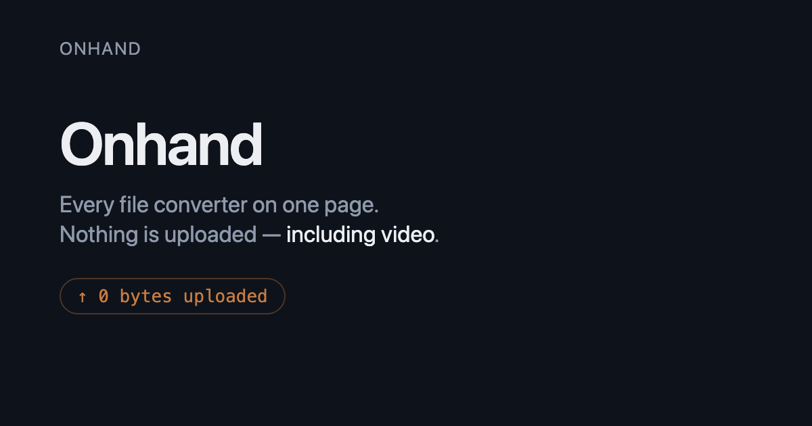

<picture>
  <source media="(prefers-color-scheme: dark)" srcset="assets/banner-dark.png">
  
</picture>

I build local-first AI tools and help teams put AI to work at AI Tappers and The AI Advantage.

### Things I've built

<table>
  <tr>
    <td width="50%" valign="top">
      
      
<b><a href="https://github.com/SirSicard/inkwell">Inkwell</a></b> 
      Free, local-first dictation and meeting notes for Mac and Windows. Speech recognition on your own machine, no account, no telemetry. 
      <a href="https://getinkwell.vercel.app">getinkwell.vercel.app</a>

    </td>
    <td width="50%" valign="top">
      
      
<b><a href="https://github.com/SirSicard/onhand">onhand</a></b> 
      Every file converter on one page. Runs entirely in your browser; nothing is uploaded, including video. 
      <a href="https://onhand.pages.dev">onhand.pages.dev</a>

    </td>
  </tr>
</table>

### Contributing to

- [**raea**](https://github.com/shinyobjectz/raea): Render Anything Engine. Video, motion graphics, 3D and games as React and TypeScript, rendered on your own GPU. [raea.io](https://raea.io)

### Find me

[LinkedIn](https://www.linkedin.com/in/mattiasherzig/) · [Instagram](https://www.instagram.com/mattiasherzig/)
